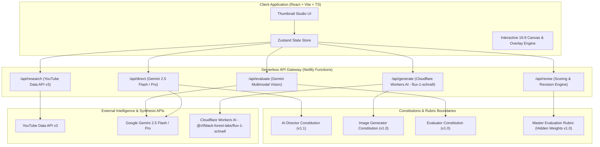
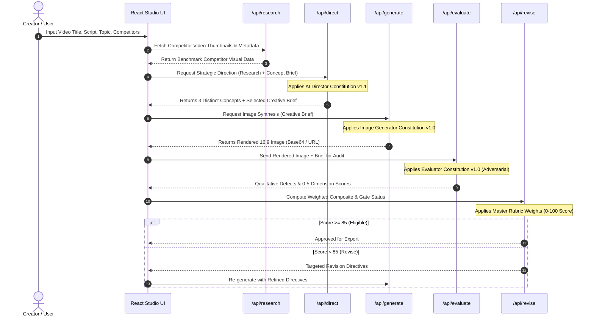

# System Architecture & Technical Specifications

**Document Version:** 1.0.0  
**Status:** Canonical System Design  
**Target Platform:** React + Vite + TypeScript Frontend, Netlify Serverless Functions Backend

---

## 1. System Overview

The **AI Thumbnail Intelligence System** is an enterprise-grade automated creative pipeline designed to research, conceptualize, generate, evaluate, and iteratively refine YouTube thumbnails.

Unlike simple single-prompt image generation tools, this system implements **strict separation of authority** between strategic direction, technical prompt crafting, independent adversarial evaluation, and scoring governance.



---

## 2. Separation of Authority & Security Model

The system enforces architectural isolation to prevent AI models from gaming their own evaluations or hallucinating results:

```
┌────────────────────────────────────────────────────────────────────────┐
│                      ISOLATION OF AUTHORITY                            │
├─────────────────────┬──────────────────────────┬───────────────────────┤
│ Role                │ Authorized Knowledge     │ Strictly Forbidden    │
├─────────────────────┼──────────────────────────┼───────────────────────┤
│ AI Director         │ Video thesis, audience,  │ Evaluation Rubric     │
│                     │ competitor benchmarks,   │ Weights, scoring      │
│                     │ Director Constitution    │ formulas, gate rules  │
├─────────────────────┼──────────────────────────┼───────────────────────┤
│ Image Generator     │ Creative Brief, model    │ Strategic rationale,  │
│                     │ syntax limits, Generator │ Rubric weights,       │
│                     │ Constitution             │ Evaluator feedback    │
├─────────────────────┼──────────────────────────┼───────────────────────┤
│ Evaluator           │ Rendered image pixels,   │ Director thoughts,    │
│                     │ brief requirements,      │ Rubric weights,       │
│                     │ Evaluator Constitution   │ quantitative formulas │
├─────────────────────┼──────────────────────────┼───────────────────────┤
│ Revision Controller │ Rubric weights, Hard     │ Creative generation,  │
│                     │ Gate logic, qualitative  │ prompt modifications  │
│                     │ Evaluator reports        │                       │
└─────────────────────┴──────────────────────────┴───────────────────────┘
```

### Security & Credential Protection
1. **Server-Side API Key Storage:** All API keys (`GEMINI_API_KEY`, `CLOUDFLARE_API_TOKEN`, `CLOUDFLARE_ACCOUNT_ID`, `YOUTUBE_API_KEY`, `APP_ACCESS_CODE`) remain strictly inside Netlify environment variables. Zero credentials are leaked to client bundles.
2. **Hidden Rubric Enforcement:** The Evaluator LLM is passed an unweighted rubric schema. The numerical weights ($W_i$) and formula calculations exist solely in the serverless backend controller (`functions/evaluate.ts` / `functions/revise.ts`).

---

## 3. Six-Stage Pipeline Flow



### Pipeline Stage Details

1. **Stage 1: Research & Competitive Intelligence (`/api/research`)**
   - Queries YouTube Data API v3 for top-ranking thumbnails in the target niche.
   - Extracts visual attributes: face presence, saturation tendencies, title length.
   - Summarizes baseline competitive tropes.

2. **Stage 2: Strategic Creative Direction (`/api/direct`)**
   - Analyzes audience mindset (Search vs. Browse).
   - Generates three structurally distinct concepts (Stakes vs. Curiosity vs. Human Emotion).
   - Selects optimal concept with explicit justification and outputs an exhaustive Creative Brief.

3. **Stage 3: Image Generation (`/api/generate`)**
   - Formulates precise prompt syntax for `flux-1-schnell` on Cloudflare Workers AI.
   - Enforces text-free generation and reserves timestamp safety zones.
   - Synthesizes 16:9 image asset.

4. **Stage 4: Adversarial Evaluation (`/api/evaluate`)**
   - Ingests generated image via Gemini Multimodal Vision API.
   - Executes 7 Hard Gate compliance sweeps.
   - Audits 10 dimensions on a 0–5 anchor scale with specific defect coordinates.

5. **Stage 5: Scoring & Decision Governance (`/api/revise`)**
   - Applies confidential Master Rubric weighting formula.
   - Calculates normalized score (0–100).
   - Determines routing status: `ELIGIBLE`, `REVISE`, `SUBSTANTIAL_REVISION`, or `REJECT`.

6. **Stage 6: Dynamic Typography & Export**
   - High-performance HTML5 Canvas / SVG overlay engine renders crisp vector text, drop shadows, and visual accents over the clean generated image.
   - Instant export to YouTube-standard 1280×720 PNG/JPG (< 2MB).

---

## 4. API Endpoint Contracts

### 1. `POST /api/research`
- **Request Body:**
  ```json
  {
    "query": "build an ai agent from scratch",
    "maxResults": 10
  }
  ```
- **Response:**
  ```json
  {
    "competitors": [
      {
        "videoId": "abc123xyz",
        "title": "Build AI Agents in 10 Minutes",
        "thumbnailUrl": "https://i.ytimg.com/vi/abc123xyz/maxresdefault.jpg",
        "channelTitle": "AI Devs",
        "viewCount": 240000
      }
    ],
    "patterns": {
      "dominantColors": ["blue", "neon purple"],
      "facePresenceRatio": 0.8
    }
  }
  ```

### 2. `POST /api/direct`
- **Request Body:**
  ```json
  {
    "videoTitle": "Building an Autonomous AI Agent in 2026",
    "videoSummary": "Complete deep-dive tutorial demonstrating custom LLM agents...",
    "niche": "Software Engineering / AI",
    "competitorData": { ... }
  }
  ```
- **Response:** Schema conforming to `AI_DIRECTOR_CONSTITUTION_v1_1.md` (3 concepts, rationale, full creative brief).

### 3. `POST /api/generate`
- **Request Body:**
  ```json
  {
    "creativeBrief": { ... },
    "aspectRatio": "16:9"
  }
  ```
- **Response:**
  ```json
  {
    "imageBase64": "data:image/jpeg;base64,...",
    "promptUsed": "...",
    "seed": 421893
  }
  ```

### 4. `POST /api/evaluate`
- **Request Body:**
  ```json
  {
    "imageBase64": "data:image/jpeg;base64,...",
    "creativeBrief": { ... },
    "videoTitle": "Building an Autonomous AI Agent in 2026"
  }
  ```
- **Response:** Schema conforming to `EVALUATOR_CONSTITUTION_v1_0.md` (gate sweep + 10 dimension scores 0–5).

### 5. `POST /api/revise`
- **Request Body:**
  ```json
  {
    "evaluationReport": { ... },
    "currentBrief": { ... },
    "iteration": 1
  }
  ```
- **Response:**
  ```json
  {
    "compositeScore": 88.4,
    "verdict": "ELIGIBLE",
    "hardGatesPassed": true,
    "revisedPrompt": null
  }
  ```

---

## 5. Future n8n Orchestration Integration Points

The system is designed with headless webhooks enabling n8n low-code workflow automation:
- **Trigger:** YouTube Studio draft video uploaded or new row added to Notion / Airtable video backlog.
- **n8n Webhook Target:** Calls `/api/direct` -> `/api/generate` -> `/api/evaluate`.
- **Conditional Branching:** If composite score >= 85, post preview to Slack / Discord for one-click creator sign-off; if < 85, re-route through `/api/revise` up to 2 automated loops.
