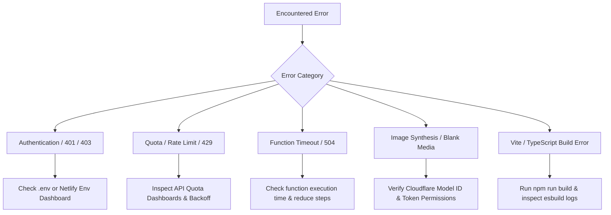

# Troubleshooting & Diagnostics Guide

**Document Version:** 1.0.0  
**Effective Date:** October 2026  
**Scope:** Root-cause analysis and remediation for AI Thumbnail Intelligence System

---

## 1. Quick Diagnostic Flowchart

---

## 2. API-Specific Errors & Remediation

### A. Google Gemini API Errors

| Symptom / HTTP Code | Root Cause | Remediation Procedure |
| :--- | :--- | :--- |
| `400 Bad Request: INVALID_ARGUMENT` | Payload JSON malformed or image base64 data URL prefix included improperly. | Strip data URI prefixes (`data:image/jpeg;base64,`) when sending raw inline data bytes to Gemini Vision SDK. |
| `401 Unauthorized` | Invalid `GEMINI_API_KEY`. | Regenerate API key at Google AI Studio. Ensure no trailing whitespace in `.env`. |
| `403 Forbidden: API key not valid` | Gemini API service not activated on the GCP project. | Check Google Cloud Console; verify "Generative Language API" is enabled. |
| `429 Too Many Requests` | Hit per-minute token or request quota. | The pipeline includes automatic exponential backoff. In free tiers, wait 60s between complex analyses or upgrade to pay-as-you-go. |
| `Safety Block / Candidate Finish: SAFETY` | Image or prompt flagged by Gemini safety filters. | Review prompt for accidental sensitive keywords (violence, weapon terms). Soften descriptive phrasing. |

---

### B. Cloudflare Workers AI Errors

| Symptom / HTTP Code | Root Cause | Remediation Procedure |
| :--- | :--- | :--- |
| `401 Unauthorized: Invalid token` | Cloudflare API Token is expired, misspelled, or revoked. | Generate a new custom API token with **Workers AI: Edit** permissions. |
| `10000 Authentication Error` | `CLOUDFLARE_ACCOUNT_ID` does not match the token's scope. | Double-check that your Account ID (32 hex characters) is exact in Netlify environment settings. |
| `500 Internal Server Error` | Model cold boot failure or unsupported image resolution. | Verify that width and height are divisible by 8 (e.g., 1280×720 or 1024×576). For `flux-1-schnell`, set steps to `4`. |
| `Binary response parsing failure` | Server function expected JSON but Workers AI returned raw JPEG/PNG octet stream. | Update fetch handler to read `response.arrayBuffer()` and convert to Base64: `Buffer.from(buffer).toString('base64')`. |

---

### C. YouTube Data API v3 Errors

| Symptom / HTTP Code | Root Cause | Remediation Procedure |
| :--- | :--- | :--- |
| `403 Quota Exceeded (quotaExceeded)` | 10,000 daily free units exhausted. | Wait until 12:00 AM PST for quota reset, or request higher quota in Google Cloud Console. Enable Demo/Mock Mode in settings. |
| `403 Access Not Configured` | YouTube Data API v3 is not enabled in the project. | Go to GCP Console -> APIs & Services -> Enable "YouTube Data API v3". |
| `400 Bad Request (keyInvalid)` | Key is restricted to wrong IP or HTTP referrers. | In GCP Console Credentials, set API key restrictions to "None" or restrict strictly to "YouTube Data API v3" rather than domain referrers (server functions call from dynamic IPs). |

---

## 3. Serverless Function Timeouts & Performance

### 10-Second Netlify Timeout Limit (`504 Gateway Timeout`)
Netlify free serverless functions have a default synchronous execution ceiling of **10 to 26 seconds**.
- **Root Cause:** Executing YouTube search + Gemini director + Cloudflare image generation + Gemini evaluation in a single monolithic API call exceeds 26 seconds.
- **Architecture Solution:** The pipeline uses **decoupled micro-endpoints**:
  - `/api/research` (~800ms)
  - `/api/direct` (~2.5s)
  - `/api/generate` (~3.5s)
  - `/api/evaluate` (~3.0s)
  - `/api/revise` (~400ms)
- Each stage completes independently, and state is preserved on the client store.

---

## 4. Image Generation Failures & Degraded Outputs

### Issue: Generated Image is Blank, Distorted, or Wrong Ratio
1. **Model Parameter Check:** Ensure `flux-1-schnell` is not receiving legacy Stable Diffusion parameters (e.g., negative prompts or guidance scales > 15 may distort Flux outputs).
2. **Aspect Ratio Enforcement:** Check that canvas dimensions are strictly 16:9 (`1280×720` or `1024×576`).
3. **Corrupted Stream:** Verify Netlify Function returns valid base64 image encoding with appropriate mime headers (`data:image/jpeg;base64,...`).

---

## 5. Build & Deployment Diagnostics

### Vite / TypeScript Build Errors
- **Error:** `Cannot find module '@netlify/functions'`
  - **Fix:** Run `npm install --save-dev @netlify/functions` and check `tsconfig.json`.
- **Error:** `Dynamic require of "..." is not supported`
  - **Fix:** In `netlify.toml`, ensure `[functions]` specifies `node_bundler = "esbuild"`.
- **Error:** Missing Environment Variables at Build Time
  - Note: Frontend Vite variables must be prefixed with `VITE_` if consumed in browser bundles, but pipeline functions read server-side `process.env` directly in Netlify Functions. Never expose sensitive secret keys as `VITE_` variables.

---

## 6. Access Code Protection Troubleshooting

If `APP_ACCESS_CODE` is enabled:
- **Error:** `401 Unauthorized: Invalid or missing access code`
- **Fix:** Verify client requests send the `x-app-access-code` header matching the server's environment variable.
- In development, clearing browser local storage or updating `.env` requires restarting `netlify dev`.
